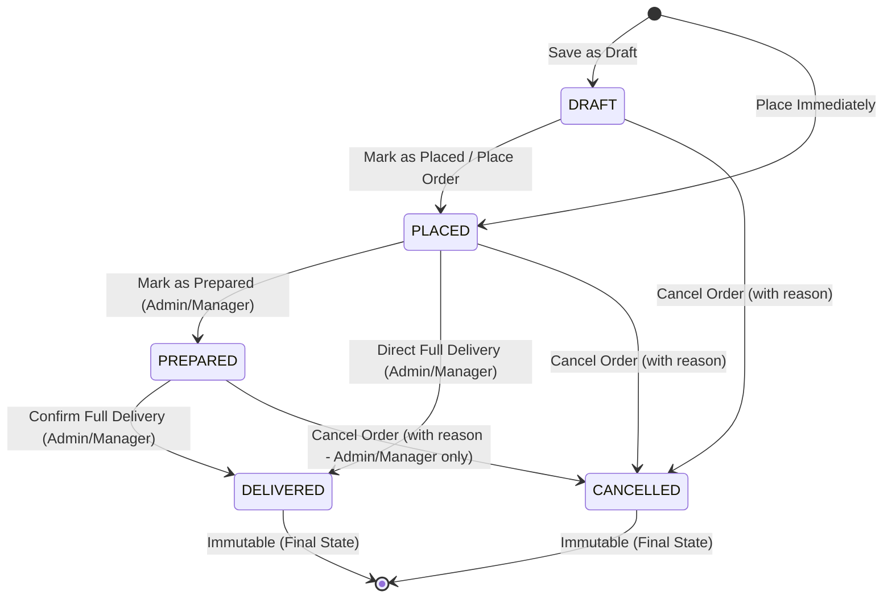
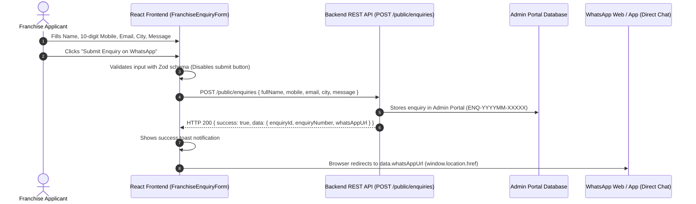

# Daddy Soda House - Franchise Management Portal (Frontend)

Centralized franchise operations, telemetry, and management portal for **Daddy Soda House**. Built using React 18+, Vite, TypeScript, and Tailwind CSS.

---

## Technology Stack

- **Framework**: [React 18+](https://react.dev/) + [Vite](https://vitejs.dev/)
- **Language**: [TypeScript](https://www.typescriptlang.org/) (Strict Mode)
- **Styling**: [Tailwind CSS](https://tailwindcss.com/) with fresh soda-inspired deep teal/green palette
- **Routing**: [React Router DOM v6](https://reactrouter.com/) (Role-based Protected Routing)
- **State & Data Fetching**: [TanStack Query v5](https://tanstack.com/query/latest)
- **HTTP Client**: [Axios](https://axios-http.com/) with bearer token injection and global 401 interception
- **Forms & Validation**: [React Hook Form](https://react-hook-form.com/) + [Zod](https://zod.dev/)
- **Icons**: [Lucide React](https://lucide.dev/)
- **Testing**: [Vitest](https://vitest.dev/) + [React Testing Library](https://testing-library.com/)

---

## Prerequisites

- **Node.js**: `v18.x`, `v20.x`, or `v22+` / `v26+`
- **npm**: `v9+` or `v10+`
- **Backend API**: Spring Boot REST API must be running locally on port **8080** with base URL `http://localhost:8080/api/v1`.

---

## Getting Started

### 1. Clone the repository & Navigate to project directory
```bash
cd Daddy_Soda_FE
```

### 2. Install dependencies
```bash
npm install
```

### 3. Configure Environment Variables
Copy the example environment configuration file:
```bash
cp .env.example .env
```
Ensure `.env` contains:
```env
VITE_API_BASE_URL=http://localhost:8080/api/v1
```

> [!NOTE]
> Backend REST API must be running locally at `http://localhost:8080`.

### 4. Start Development Server
```bash
npm run dev
```
The application will launch at `http://localhost:3000`.

---

## Available Scripts

| Command | Description |
| :--- | :--- |
| `npm run dev` | Starts Vite local development server on port 3000 |
| `npm run build` | Compiles TypeScript and builds production assets in `dist/` |
| `npm run preview` | Previews production build locally |
| `npm test` | Executes Vitest test suite in single-run mode |
| `npm run test:watch` | Starts Vitest interactive watch mode |

---

## Role-Based Access Control

The portal strictly segregates user experiences based on backend roles:

| Role | Default Landing | Accessible Routes & Modules |
| :--- | :--- | :--- |
| `SUPER_ADMIN` | `/dashboard` | Operational Dashboard, Master Data (Franchises, Outlets, Machines, Products, Suppliers, User Logins), Purchases, Inventory, Orders, Invoices, Dues, Reports, Enquiries, IoT, Manual Daily Sales |
| `MANAGER` | `/dashboard` | Same operational modules as Super Admin (excluding User Logins management `/users`) |
| `FRANCHISE_OWNER` | `/my-dashboard` | My Dashboard (with Compact Franchise Card & Outlets), My Machines (`/my-machines`), My Orders, My Invoices, My Due Payments, My Monthly Reports, Manual Daily Sales |

> [!CAUTION]
> If a `FRANCHISE_OWNER` attempts to access admin routes (e.g., `/dashboard`, `/franchises`, `/outlets`, `/machines`, `/products`, `/suppliers`, `/users`), they are blocked and directed to `/unauthorized` (HTTP 403 Access Denied).
> Unauthenticated users accessing any protected route are redirected to `/login`.

---

## Master Data Module (FE-02)

The Master Data module provides full lifecycle management (Create, Read, Update, Status Toggle) for core operational entities.

### Entity Creation Dependency Order
Due to relational constraints, entities must be provisioned in the following order:
1. **Franchise** (`/franchises`): Create and activate the Franchise entity first.
2. **Outlet** (`/outlets`): Requires an **active Franchise** to be selected.
3. **Machine** (`/machines`): Cascading selection requires choosing a Franchise first to view its **active Outlets**, and then assigning the Machine to an Outlet. Includes optional IoT Device ID and display-only Last Telemetry timestamp.
4. **Flavours / Products** (`/products`): Independent catalog. Defaults bottle size to **5.00 L** and formats unit prices in currency (`₹ 0.00`).
5. **Suppliers** (`/suppliers`): Independent catalog. Includes optional 15-character GSTIN format validation.

### Franchise Owner User Creation Workflow
1. Navigate to **Masters > Franchises** (`/franchises`) and create the franchise record (e.g., "Downtown Express").
2. Navigate to **Masters > User Logins** (`/users`) *(Super Admin only)*.
3. Click **Add User**, set Role to `FRANCHISE_OWNER`.
4. The **Assigned Franchise** dropdown will dynamically appear and become mandatory. Select the newly created franchise.
5. Provide the mobile number (10 digits), full name, email, and a temporary password (min 6 characters).
6. The Franchise Owner can now log in via `/login` and is automatically redirected to `/my-dashboard` with isolated access to their franchise telemetry, outlets, and machines (`/my-machines`).

---

## Purchase Bills & Warehouse Inventory Module (FE-03)

The Purchase and Warehouse Inventory module handles stock replenishment, inventory tracking, movement audit logging, and manual stock corrections.

### Key Business Rules & Workflows
1. **Purchase Bill Inward Workflow** (`/purchases/new`):
   - Physical supplier delivery bills are entered manually to record syrup stock inward.
   - Each purchase bill specifies an active supplier, bill date, optional supplier bill number, and one or more flavour line items.
   - **No Financial / Price Data**: The module strictly records bottle quantities. Purchase price, rates, GST, taxes, and supplier payment ledgers are explicitly excluded.
   - **Immediate Inventory Increment**: Saving a purchase bill immediately adds the specified bottle quantities to warehouse inventory and logs a `PURCHASE_IN` movement.
2. **Cancellation Over Editing**:
   - Confirmed purchase bills **cannot be edited or deleted**.
   - If an error was made during inward entry, the bill must be **cancelled** with a mandatory cancellation justification.
   - Cancellation triggers a `PURCHASE_CANCEL_REVERSAL` movement and reverses stock **only if current warehouse inventory is sufficient**. If stock has already been dispatched, the backend rejects the cancellation with an informative error.
3. **Warehouse Stock Updates** (`/inventory`):
   - Warehouse stock increases through confirmed purchases and manual stock adjustments.
   - Warehouse stock decreases through order deliveries (subsequent module) or manual stock reductions.
   - Visual cues: Items with `quantity > 0` are badged `IN STOCK` (green), while `quantity = 0` triggers an explicit `OUT OF STOCK` treatment (red).
4. **Manual Stock Adjustments** (`StockAdjustmentModal`):
   - Used for physical inventory discrepancies, handling damage, breakage, or sample returns.
   - Supports `Add Stock` (`ADJUSTMENT_IN`) and `Reduce Stock` (`ADJUSTMENT_OUT`).
   - Requires a positive decimal quantity and a mandatory reason/note (max 500 characters).
   - Prevents negative inventory stock balances.
5. **Stock Movement Audit Trail** (`/inventory/movements`):
   - Complete ledger capturing all additions, cancellations, manual corrections, and dispatches.
   - Filterable by flavour/product, movement type, and date range.

---

## Franchise Orders, Order Management & Delivery Module (FE-04)

The Franchise Orders and Delivery module governs the replenishment lifecycle of syrup bottles from franchise order placement through warehouse preparation and final delivery.

### Order Status Lifecycle


### Key Business Rules & Workflows
1. **Delivery-Time Warehouse Stock Deduction**:
   - Central warehouse inventory is deducted **only upon successful order delivery (`DELIVERED`)**.
   - No stock is deducted or reserved during `DRAFT`, `PLACED`, or `PREPARED` statuses.
   - Successful delivery records stock deductions and invalidates both order queries and warehouse inventory cache (`['warehouse-inventory']`, `['stock-movements']`).
2. **No Stock Reservation & No Partial Delivery (V1)**:
   - Orders can be created and placed regardless of current warehouse stock levels.
   - Deliveries are **full delivery only**; partial fulfillment or backorders are not supported in V1.
   - If central warehouse stock is insufficient at the moment of delivery confirmation, the backend rejects the delivery mutation and the UI renders the exact flavour names and insufficient quantities clearly.
3. **Role-Based Price Autofill & Modification**:
   - Product default selling prices auto-fill from the Product Master (`defaultSellingPrice`).
   - **Super Admin & Manager**: Permitted to adjust/override unit prices on both creation and edit forms.
   - **Franchise Owner**: Unit prices are strictly **display-only**. Franchise owners cannot modify prices. Request payloads sent by Franchise Owners omit `franchiseId` and `unitPrice`.
   - If a product has no default price configured in Product Master, Franchise Owner is alerted with: *"Price is not configured for this flavour. Please contact the manager."* and submission is blocked.
4. **Order Immutability & Deletion**:
   - `DELIVERED` and `CANCELLED` orders are completely immutable. They cannot be edited, cancelled, or deleted.
   - **Delete Action**: Only `DRAFT` orders can be permanently deleted.
   - **Cancellation Reason**: Order cancellation requires a mandatory reason (up to 500 characters) which is permanently stored in the order audit trail.

### Order Permissions by Role

| Action / Capability | Super Admin | Manager | Franchise Owner |
| :--- | :---: | :---: | :---: |
| Access `/orders` (All Franchises) | Yes | Yes | No (403 Restricted) |
| Access `/my-orders` (Self-Service) | No | No | Yes (Isolated Own Data) |
| Create Order with Franchise Selector | Yes | Yes | No (Implicit from Session) |
| Edit Unit Selling Prices | Yes | Yes | No (Display-Only) |
| Edit Orders | DRAFT / PLACED | DRAFT / PLACED | DRAFT Only |
| Mark as Placed | DRAFT Only | DRAFT Only | DRAFT Only |
| Mark as Prepared | PLACED Only | PLACED Only | No Access |
| Deliver Order (Deduct Stock) | PLACED / PREPARED | PLACED / PREPARED | No Access |
| Cancel Order (with Reason) | DRAFT / PLACED / PREPARED | DRAFT / PLACED / PREPARED | DRAFT / PLACED Only |
| Delete Order | DRAFT Only | DRAFT Only | DRAFT Only |
| View Warehouse Stock Helper | Yes (Informational) | Yes (Informational) | No |

---

## Backend Integration Details

### Authentication Endpoints
- `POST /api/v1/auth/login` - User login with `{ mobile, password }`
- `GET /api/v1/auth/me` - Validates current token and returns active session user profile
- `POST /api/v1/auth/logout` - Logs out the active session
- `GET /api/v1/public/status` - Checks whether backend server is reachable ("System online")

### Master Data Endpoints (FE-02)
- **Franchises**: `POST/GET /franchises`, `GET/PUT /franchises/{id}`, `PATCH /franchises/{id}/status`
- **Outlets**: `POST/GET /outlets`, `GET/PUT /outlets/{id}`, `PATCH /outlets/{id}/status`
- **Machines**: `POST/GET /machines`, `GET/PUT /machines/{id}`, `PATCH /machines/{id}/status`
- **Products**: `POST/GET /products`, `GET/PUT /products/{id}`, `PATCH /products/{id}/status`
- **Suppliers**: `POST/GET /suppliers`, `GET/PUT /suppliers/{id}`, `PATCH /suppliers/{id}/status`
- **User Logins** *(Super Admin)*: `POST/GET /users`, `PATCH /users/{id}/status`
- **Franchise Self-Service**: `GET /my/machines`, `GET /my/franchise`, `GET /my/outlets`

### Purchases & Inventory Endpoints (FE-03)
- **Purchases**:
  - `POST /api/v1/purchases` - Create purchase bill and add quantities to warehouse stock
  - `GET /api/v1/purchases` - Paginated list with supplier, bill number, status, and date filters
  - `GET /api/v1/purchases/{id}` - Purchase bill detail and line items
  - `POST /api/v1/purchases/{id}/cancel` - Cancel confirmed purchase bill and reverse stock
- **Warehouse Inventory**:
  - `GET /api/v1/inventory/warehouse` - Real-time stock levels with in-stock/out-of-stock indicators
  - `GET /api/v1/inventory/warehouse/{productId}` - Single product stock and recent movement history
  - `GET /api/v1/inventory/movements` - Full paginated stock movement audit trail
  - `POST /api/v1/inventory/adjustments` - Record manual stock adjustment (`ADJUSTMENT_IN` / `ADJUSTMENT_OUT`)

### Orders & Delivery Endpoints (FE-04)
- **Admin & Manager Operations**:
  - `GET /api/v1/orders` - Paginated orders list with franchise, status, order number, and date filters
  - `GET /api/v1/orders/{id}` - Complete order details, line items, and audit timestamps
  - `POST /api/v1/orders` - Create order with target franchise, line items, and optional price overrides
  - `PUT /api/v1/orders/{id}` - Update order details for DRAFT or PLACED orders
  - `POST /api/v1/orders/{id}/place` - Transition DRAFT order to PLACED status
  - `POST /api/v1/orders/{id}/prepare` - Transition PLACED order to PREPARED status
  - `POST /api/v1/orders/{id}/deliver` - Execute full delivery and deduct warehouse inventory
  - `POST /api/v1/orders/{id}/cancel` - Cancel order with mandatory reason payload `{ reason }`
  - `DELETE /api/v1/orders/{id}` - Permanently delete DRAFT order
- **Franchise Owner Self-Service**:
  - `GET /api/v1/my/orders` - Filtered order list strictly scoped to authenticated franchise

## Invoices & Payment Collection Module (FE-05)

The Invoices & Payments module handles downstream commercial settlement following physical delivery of sales orders.

### 1. Delivery-Triggered Invoicing
- **Prerequisite**: Invoices can **only** be created from sales orders in `DELIVERED` status (`GET /orders?status=DELIVERED`).
- **One Invoice Per Order**: The backend enforces exactly one invoice per delivered order. Any attempt to create a duplicate invoice displays clear backend validation feedback.
- **Immutable Item Snapshot**: Item codes, flavours, bottle sizes, delivered quantities, and agreed unit prices are mirrored directly from the delivered order snapshot. They are strictly display-only in the invoice generation screen and cannot be edited.

### 2. GST vs Normal Billing
- **Normal Invoice**: Zero tax is applied (`gstRate: 0`, `gstAmount: 0`). Tax rate controls are hidden from the UI.
- **GST Invoice**: Tax rate defaults from backend configuration (18%) and can be adjusted by Super Admin or Manager. Grand Total is computed as `Subtotal + GST Amount`.

### 3. Payment Terms & 10-Day Credit Due-Date Rule
- **Payment Terms**:
  - `CREDIT`: Due date is automatically defaulted to **Invoice Date + 10 days** in the UI.
  - `PARTIAL_PAYMENT`: Due date is automatically defaulted to **Invoice Date + 10 days** in the UI.
  - `FULL_PAYMENT`: Due date is hidden and cleared (`dueDate: null`). Immediate settlement on delivery.
- **Due Date Extension**: Super Admin or Manager can modify the due date via the **Update Due Date** modal (`PATCH /invoices/{id}/due-date`). A mandatory audit reason (up to 500 characters) is required. The new due date cannot precede the original invoice date.

### 4. Manual Offline Payment Collection
- Payments are entered manually by Super Admin or Manager (`POST /invoices/{id}/payments`).
- Supported modes: `UPI`, `BANK_TRANSFER`, `CASH`, `CHEQUE`, `OTHER`.
- **Validation**: Payment amount must be `> 0` and cannot exceed the current outstanding balance (`balanceAmount`). Submissions exceeding the balance are blocked client-side and server-side.
- **Real-Time Settlement**: Recording a payment updates the invoice ledger, balance amount, and payment status (`UNPAID` → `PARTIALLY_PAID` → `PAID` / `OVERDUE`).

### 5. Protected PDF Downloads
- Generated dynamically by backend service (`GET /invoices/{id}/download`).
- Consumed securely as a binary `Blob` using the authenticated Axios client.
- The UI extracts the filename from the `Content-Disposition` header or falls back safely to `invoice-{invoiceNumber}.pdf`.

### 6. Role-Based Permissions
| Capability | SUPER_ADMIN | MANAGER | FRANCHISE_OWNER |
| :--- | :---: | :---: | :---: |
| Access Invoices List (`/invoices`) | ✅ | ✅ | ❌ (Blocked) |
| Create Invoice (`/invoices/new`) | ✅ | ✅ | ❌ (Blocked) |
| View Admin Invoice Detail (`/invoices/:id`) | ✅ | ✅ | ❌ (Blocked) |
| Record Offline Payment (`POST /invoices/:id/payments`) | ✅ | ✅ | ❌ (No action) |
| Update Due Date (`PATCH /invoices/:id/due-date`) | ✅ | ✅ | ❌ (No action) |
| Access Self-Service Invoices (`/my-invoices`) | ❌ | ❌ | ✅ (Own invoices only) |
| View Self-Service Invoice (`/my-invoices/:id`) | ❌ | ❌ | ✅ (Own invoice only) |
| Download Invoice PDF | ✅ | ✅ | ✅ (Own invoice only) |

---

## Dashboards, Dues, Reports & Enquiries Module (FE-06)

The FE-06 module provides operational oversight, credit receivables tracking, monthly CSV reports, and internal franchise sales enquiry management.

### 1. Operational Dashboard (`/dashboard`)
- **Access**: `SUPER_ADMIN` and `MANAGER` only.
- **Summary Cards (12 KPIs)**:
  - Active Franchises, Outlets, Machines, Flavours/Products
  - Products In Stock, Products Out of Stock (amber/red warning state)
  - Purchases This Month, Delivered Orders This Month, Invoices This Month
  - Pending Amount (prominent styling), Overdue Amount (strict RED styling)
  - New Website Enquiries count
- **Quick Action Triggers**:
  - Add Purchase Bill (`/purchases/new`)
  - Create Order (`/orders/new`)
  - Create Invoice (`/invoices/new`)
  - View Due Payments (`/dues`)
  - View Website Enquiries (`/enquiries`)
- **Sections**:
  - **Section A ("Credit Payments Requiring Attention")**: First 5 overdue invoices (`GET /dashboard/dues?dueType=OVERDUE`) highlighted with subtle red background and border.
  - **Section B ("Due Today")**: Up to 5 invoices maturing today (`dueType=DUE_TODAY`) with amber styling.
  - **Section C ("Upcoming Due Payments")**: First 5 upcoming scheduled dues with direct link to `/dues`.

### 2. Franchise Dashboard (`/my-dashboard`)
- **Access**: `FRANCHISE_OWNER` only.
- **Self-Service Overview**:
  - Active Outlet & Machine counts
  - Orders by status breakdown (Draft, Placed, Prepared, Delivered, Cancelled)
  - Invoices billed this month, Pending Balance, Overdue Amount
  - Overdue warning banner when overdue invoices exist
  - **"My Next Payment Due"** spotlight card with color coding: RED (Overdue), AMBER (Due Today), BLUE (Upcoming)
- **Sections**:
  - **Section A ("My Recent Orders")**: Latest 5 orders linking to `/my-orders`.
  - **Section B ("My Recent Invoices")**: Latest 5 invoices linking to `/my-invoices`.

### 3. Credit Due Payments List (`/dues`)
- **Role Awareness**:
  - Super Admin & Manager see all dues across franchises (`Credit Due Payments`) with franchise filter dropdown.
  - Franchise Owner sees only own dues (`My Due Payments`) without any franchise selection dropdown (`franchiseId` is never sent to API).
- **Due-Status Visual Rules**:
  - **OVERDUE** (`displaySeverity: RED`):
    - Row highlighted with subtle red background (`bg-red-50/60`) and red left border (`border-l-4 border-red-500`).
    - Red balance text, red days overdue counter.
    - Badged clearly as `Overdue`.
  - **DUE_TODAY** (`displaySeverity: AMBER`):
    - Row highlighted with amber background (`bg-amber-50/50`) and amber left border (`border-amber-500`).
    - Badged as `Due Today`.
  - **UPCOMING** (`displaySeverity: NORMAL`):
    - Standard clean table row with `Upcoming` badge.
- **Credit Due-Date Business Logic**:
  - 10-day credit due date originates from backend invoice business rules.
  - Action buttons only link to Invoice Detail (`/invoices/:id` or `/my-invoices/:id`).
  - No payment entry or due-date editing actions are displayed on the dues list itself (managed inside invoice details).

### 4. Monthly CSV Report Downloads (`/reports` & `/my-reports`)
- **Protected CSV Downloads**:
  - Consumed securely as binary `Blob` with authenticated Axios client.
  - Filename dynamically extracted from `Content-Disposition` header with safe fallback.
  - Download buttons display "Preparing Download..." spinner and disable during generation.
- **Admin & Manager Reports (`/reports`)**:
  1. **Monthly Purchases** (`GET /reports/monthly/purchases/download`): Filters by mandatory month (`YYYY-MM`) and optional supplier.
  2. **Monthly Orders** (`GET /reports/monthly/orders/download`): Filters by mandatory month (`YYYY-MM`), optional franchise, and order status.
  3. **Monthly Invoices** (`GET /reports/monthly/invoices/download`): Filters by mandatory month (`YYYY-MM`), optional franchise, invoice type, and payment status.
  4. **Monthly Due Payments** (`GET /reports/monthly/dues/download`): Filters by mandatory month (`YYYY-MM`).
- **Franchise Owner Reports (`/my-reports`)**:
  - Access to 3 reports: My Monthly Orders, My Monthly Invoices, and My Monthly Due Payments.
  - Purchases report, franchise selectors, and supplier filters are completely omitted.
  - Hits the same endpoints without franchise ID parameters.

### 5. Internal Website Enquiry Management (`/enquiries`)
- **Access**: `SUPER_ADMIN` and `MANAGER` only.
- **Workflow**:
  - Inquiries originate from public website submissions.
  - Internal users manage status transitions: `NEW` → `CONTACTED` → `CLOSED`.
  - Read-only lead viewing drawer/modal with applicant details, city, mobile, message, source, notes, and timestamps.
  - Update Status modal allowing status progression and optional admin audit notes with validation feedback.
- **Scope Constraints**:
  - No enquiry deletion.
  - No email or WhatsApp API automation.
  - No lead assignment or automated reminder workflows in this version.

## Public Marketing Website & Franchise Enquiry Flow (FE-08)

The FE-08 module delivers the public-facing marketing website and franchise enquiry generation flow for Daddy Soda House.

### 1. Public Routes Overview

| Route | Page | Purpose |
| :--- | :--- | :--- |
| `/` | `HomePage` | Hero showcase, Why Daddy Soda House, Featured Flavours, Onboarding Steps, FAQ Preview, Enquiry CTA |
| `/about` | `AboutPage` | Brand overview, vision & mission placeholders, product philosophy, values |
| `/products` | `ProductsPage` | Flavour catalog with category filters (informational; no pricing or ordering) |
| `/franchise` | `FranchisePage` | Main franchise conversion page with setup process, benefits, FAQs, and embedded enquiry form |
| `/contact` | `ContactPage` | Corporate contact details, address, office hours, and embedded enquiry form |
| `/privacy-policy` | `PrivacyPolicyPage` | Structured data protection and privacy policy with legal review banner |
| `/terms-and-conditions` | `TermsAndConditionsPage` | Website usage terms, franchise disclaimer, no guaranteed returns clause |

> [!NOTE]
> Public pages use a dedicated `PublicLayout` featuring `PublicHeader`, sticky navigation, mobile drawer menu, non-blocking `PublicStatusBanner`, and `PublicFooter`.
> A visible **"Partner Login" / "Portal Login"** link connects visitors to the internal management portal (`/login`).
> Internal dashboard routes remain protected and redirect unauthenticated users to `/login`.

### 2. Critical Franchise Enquiry & WhatsApp Redirect Flow



#### Key Rules:
- **Save First, Redirect After**: WhatsApp is **never** opened before a successful backend response (`HTTP 200 OK`).
- **No Manual URL Building**: Frontend uses the backend-provided `whatsAppUrl` directly from the response payload.
- **Error Handling**: If the API call fails or the network errors, an error toast is displayed and **no redirect takes place**.
- **No Sensitive Local Storage**: No enquiry form data is saved in `localStorage` or `sessionStorage`.
- **Consent Notice**: Clear consent text is displayed on every enquiry form.

> [!IMPORTANT]
> **Explicit Architecture Note**:
> - **No Email Service**: No transactional or marketing emails are sent.
> - **No WhatsApp Business API**: Direct customer chat URL redirect only (`https://wa.me/...`).
> - **No Customer Cart / Ordering**: Flavor catalog is purely informational.
> - **No Payment Gateway / Customer Logins**: Only authorized internal partners/admins log in.

### 3. Replaceable Content & Production Asset Checklist

All public marketing copy, product cards, FAQs, and contact coordinates are centralized in `src/config/siteConfig.ts` for simple client review and customization.

Before launching to production, replace the following placeholders in `src/config/siteConfig.ts` or `public/`:
- [ ] **Brand Logo**: Replace SVG/PNG logo in `siteConfig.brand.logoUrl` and `public/favicon.ico`.
- [ ] **Brochure & Hero Images**: Update hero banners and setup process imagery.
- [ ] **Product Flavour Images**: Replace high-resolution soda bottle and dispensing machine photos.
- [ ] **Contact Information**: Confirm official Head Office address, phone numbers, and WhatsApp numbers.
- [ ] **Legal Review**: Have legal counsel review and finalize `PrivacyPolicyPage.tsx` and `TermsAndConditionsPage.tsx`.

### 4. Public API Health Monitoring

- Public layout checks `GET /api/v1/public/status`.
- If backend service is down or unreachable, a subtle, non-blocking banner is rendered:
  *"Enquiry service is temporarily unavailable. Please try again shortly."*
- Page rendering is never blocked by health status failures.

---

### Standard Response Format
```json
{
  "success": true,
  "message": "Operation description",
  "data": { ... },
  "timestamp": "2026-09-23T10:00:00Z"
}
```

---

## Folder Structure

```
src/
├── api/                  # Axios instance, interceptors, error parsers, and typed API clients (auth, master, inventory, order, invoice, dashboard, telemetry, public)
├── components/
│   ├── common/           # Common components (Breadcrumb, PageHeader, ErrorMessage, TableSkeleton, StatusBadge, etc.)
│   ├── enquiries/        # Enquiry management components (EnquiryDetailModal, UpdateEnquiryStatusModal)
│   ├── inventory/        # Inventory components (StockAdjustmentModal)
│   ├── invoices/         # Invoice components (InvoiceStatusBadge, InvoiceTypeBadge, RecordPaymentModal, UpdateDueDateModal)
│   ├── orders/           # Order components (OrderStatusBadge, CancelOrderModal, DeliverOrderModal)
│   ├── public/           # Public website components (PublicHeader, PublicFooter, PublicStatusBanner, FranchiseEnquiryForm, FlavourCard, FaqAccordion)
│   ├── sales/            # Manual daily sales entry components
│   ├── telemetry/        # IoT device telemetry components
│   └── ui/               # Reusable primitive UI components (Button, Input, Select, Card, Modal, Table, Pagination, etc.)
├── config/               # Environment configuration, navigation definitions, and public siteConfig.ts
├── contexts/             # AuthContext and ToastContext providers
├── hooks/                # Custom hooks (useAuth, useToast, usePageMeta, useMasterData, useInventoryData, useOrderData, useInvoiceData, useDashboardData)
├── layouts/              # DashboardLayout, responsive Sidebar, Header, and PublicLayout
├── pages/
│   ├── auth/             # LoginPage
│   ├── common/           # UnauthorizedPage, NotFoundPage, ModulePlaceholderPage
│   ├── dashboard/        # AdminDashboardPage (/dashboard) & FranchiseDashboardPage (/my-dashboard)
│   ├── dues/             # DuePaymentsPage (/dues and /my-dues)
│   ├── enquiries/        # EnquiriesPage (/enquiries)
│   ├── franchise/        # Franchise Owner self-service pages (MyMachinesPage, Orders, FranchiseInvoicesPage, FranchiseInvoiceDetailPage)
│   ├── inventory/        # Warehouse Inventory, Product Detail, and Stock Movements pages
│   ├── invoices/         # Admin/Manager Invoice pages (InvoicesListPage, CreateInvoicePage, InvoiceDetailPage)
│   ├── masters/          # Master CRUD pages (Franchises, Outlets, Machines, Products, Suppliers, Users)
│   ├── orders/           # Admin/Manager Order pages (OrdersListPage, CreateOrderPage, OrderDetailPage, EditOrderPage)
│   ├── public/           # Public pages (HomePage, AboutPage, ProductsPage, FranchisePage, ContactPage, PrivacyPolicyPage, TermsAndConditionsPage)
│   ├── purchases/        # Purchase Bills list, new purchase form, and detail pages
│   ├── reports/          # MonthlyReportsPage (/reports) & FranchiseReportsPage (/my-reports)
│   ├── sales/            # ManualDailySalesPage
│   └── telemetry/        # IotTelemetryPage
├── routes/               # AppRoutes, ProtectedRoute guard, RoleRoute guard
├── types/                # TypeScript interfaces (auth, api, master, inventory, order, invoice, dashboard, telemetry, public, navigation)
└── utils/                # Utility helpers (cn, storage, formatters)
```

---

## Running Automated Tests

```bash
npm test
```
Vitest validates **93 tests across 8 test suites**:
- **Authentication & Role-Based Routing (`test/auth-flow.test.tsx`)**: 7 tests
- **Master Data Module (`test/masters.test.tsx`)**: 9 tests
- **Purchases & Inventory Module (`test/inventory.test.tsx`)**: 11 tests
- **Franchise Orders & Delivery Module (`test/orders.test.tsx`)**: 12 tests
- **Invoices & Payments Module (`test/invoices.test.tsx`)**: 11 tests
- **Dashboards, Reports & Enquiries Module (`test/dashboard-reports-enquiries.test.tsx`)**: 10 tests
- **IoT Telemetry & Manual Daily Sales Module (`test/iot-manual-sales-consumption.test.tsx`)**: 17 tests
- **Public Marketing Website & Franchise Enquiry Flow (`test/public-website-enquiry.test.tsx`)**: 16 tests
  1. Public Home page renders at `/` without authentication
  2. Public About page renders at `/about` without authentication
  3. Public Products page renders at `/products` without prices or ordering
  4. Public Franchise page renders at `/franchise` with onboarding info and enquiry form
  5. Public Contact page renders at `/contact` with corporate info and enquiry form
  6. Public Privacy Policy page renders at `/privacy-policy` with legal review banner
  7. Public Terms & Conditions page renders at `/terms-and-conditions` with legal review banner
  8. Internal dashboard route still redirects unauthenticated users to `/login`
  9. "Partner Login" button links directly to `/login`
  10. Mobile menu opens and closes accessibly
  11. Enquiry form validates mandatory name and exact 10-digit mobile
  12. Enquiry form rejects invalid email addresses
  13. Submits enquiry to `POST /public/enquiries` and redirects to backend `whatsAppUrl` on success
  14. Failed enquiry API request displays error toast and does not redirect to WhatsApp
  15. Dynamic page title and meta description updates per public route
  16. Subtle non-blocking status notification renders when public status is down


