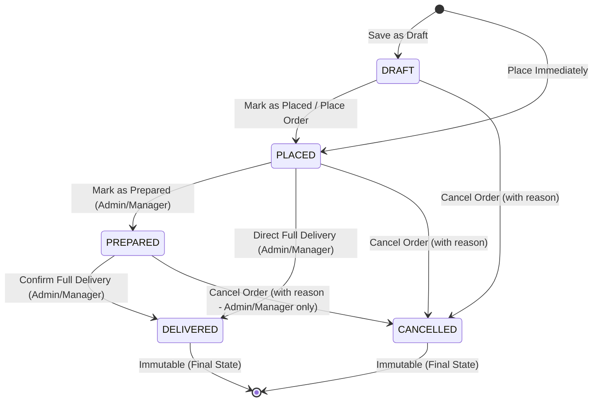

# Daddy Soda House - Franchise Management Portal (Frontend)

Centralized franchise operations, telemetry, and management portal for **Daddy Soda House**. Built using React 18+, Vite, TypeScript, and Tailwind CSS.

---

## Technology Stack

- **Framework**: [React 18+](https://react.dev/) + [Vite](https://vitejs.dev/)
- **Language**: [TypeScript](https://www.typescriptlang.org/) (Strict Mode)
- **Styling**: [Tailwind CSS](https://tailwindcss.com/) with fresh soda-inspired deep teal/green palette
- **Routing**: [React Router DOM v6](https://reactrouter.com/) (Role-based Protected Routing)
- **State & Data Fetching**: [TanStack Query v5](https://tanstack.com/query/latest)
- **HTTP Client**: [Axios](https://axios-http.com/) with bearer token injection and global 401 interception
- **Forms & Validation**: [React Hook Form](https://react-hook-form.com/) + [Zod](https://zod.dev/)
- **Icons**: [Lucide React](https://lucide.dev/)
- **Testing**: [Vitest](https://vitest.dev/) + [React Testing Library](https://testing-library.com/)

---

## Prerequisites

- **Node.js**: `v18.x`, `v20.x`, or `v22+` / `v26+`
- **npm**: `v9+` or `v10+`
- **Backend API**: Spring Boot REST API must be running locally on port **8080** with base URL `http://localhost:8080/api/v1`.

---

## Getting Started

### 1. Clone the repository & Navigate to project directory
```bash
cd Daddy_Soda_FE
```

### 2. Install dependencies
```bash
npm install
```

### 3. Configure Environment Variables
Copy the example environment configuration file:
```bash
cp .env.example .env
```
Ensure `.env` contains:
```env
VITE_API_BASE_URL=http://localhost:8080/api/v1
```

> [!NOTE]
> Backend REST API must be running locally at `http://localhost:8080`.

### 4. Start Development Server
```bash
npm run dev
```
The application will launch at `http://localhost:3000`.

---

## Available Scripts

| Command | Description |
| :--- | :--- |
| `npm run dev` | Starts Vite local development server on port 3000 |
| `npm run build` | Compiles TypeScript and builds production assets in `dist/` |
| `npm run preview` | Previews production build locally |
| `npm test` | Executes Vitest test suite in single-run mode |
| `npm run test:watch` | Starts Vitest interactive watch mode |

---

## Role-Based Access Control

The portal strictly segregates user experiences based on backend roles:

| Role | Default Landing | Accessible Routes & Modules |
| :--- | :--- | :--- |
| `SUPER_ADMIN` | `/dashboard` | Operational Dashboard, Master Data (Franchises, Outlets, Machines, Products, Suppliers, User Logins), Purchases, Inventory, Orders, Invoices, Dues, Reports, Enquiries, IoT, Manual Daily Sales |
| `MANAGER` | `/dashboard` | Same operational modules as Super Admin (excluding User Logins management `/users`) |
| `FRANCHISE_OWNER` | `/my-dashboard` | My Dashboard (with Compact Franchise Card & Outlets), My Machines (`/my-machines`), My Orders, My Invoices, My Due Payments, My Monthly Reports, Manual Daily Sales |

> [!CAUTION]
> If a `FRANCHISE_OWNER` attempts to access admin routes (e.g., `/dashboard`, `/franchises`, `/outlets`, `/machines`, `/products`, `/suppliers`, `/users`), they are blocked and directed to `/unauthorized` (HTTP 403 Access Denied).
> Unauthenticated users accessing any protected route are redirected to `/login`.

---

## Master Data Module (FE-02)

The Master Data module provides full lifecycle management (Create, Read, Update, Status Toggle) for core operational entities.

### Entity Creation Dependency Order
Due to relational constraints, entities must be provisioned in the following order:
1. **Franchise** (`/franchises`): Create and activate the Franchise entity first.
2. **Outlet** (`/outlets`): Requires an **active Franchise** to be selected.
3. **Machine** (`/machines`): Cascading selection requires choosing a Franchise first to view its **active Outlets**, and then assigning the Machine to an Outlet. Includes optional IoT Device ID and display-only Last Telemetry timestamp.
4. **Flavours / Products** (`/products`): Independent catalog. Defaults bottle size to **5.00 L** and formats unit prices in currency (`₹ 0.00`).
5. **Suppliers** (`/suppliers`): Independent catalog. Includes optional 15-character GSTIN format validation.

### Franchise Owner User Creation Workflow
1. Navigate to **Masters > Franchises** (`/franchises`) and create the franchise record (e.g., "Downtown Express").
2. Navigate to **Masters > User Logins** (`/users`) *(Super Admin only)*.
3. Click **Add User**, set Role to `FRANCHISE_OWNER`.
4. The **Assigned Franchise** dropdown will dynamically appear and become mandatory. Select the newly created franchise.
5. Provide the mobile number (10 digits), full name, email, and a temporary password (min 6 characters).
6. The Franchise Owner can now log in via `/login` and is automatically redirected to `/my-dashboard` with isolated access to their franchise telemetry, outlets, and machines (`/my-machines`).

---

## Purchase Bills & Warehouse Inventory Module (FE-03)

The Purchase and Warehouse Inventory module handles stock replenishment, inventory tracking, movement audit logging, and manual stock corrections.

### Key Business Rules & Workflows
1. **Purchase Bill Inward Workflow** (`/purchases/new`):
   - Physical supplier delivery bills are entered manually to record syrup stock inward.
   - Each purchase bill specifies an active supplier, bill date, optional supplier bill number, and one or more flavour line items.
   - **No Financial / Price Data**: The module strictly records bottle quantities. Purchase price, rates, GST, taxes, and supplier payment ledgers are explicitly excluded.
   - **Immediate Inventory Increment**: Saving a purchase bill immediately adds the specified bottle quantities to warehouse inventory and logs a `PURCHASE_IN` movement.
2. **Cancellation Over Editing**:
   - Confirmed purchase bills **cannot be edited or deleted**.
   - If an error was made during inward entry, the bill must be **cancelled** with a mandatory cancellation justification.
   - Cancellation triggers a `PURCHASE_CANCEL_REVERSAL` movement and reverses stock **only if current warehouse inventory is sufficient**. If stock has already been dispatched, the backend rejects the cancellation with an informative error.
3. **Warehouse Stock Updates** (`/inventory`):
   - Warehouse stock increases through confirmed purchases and manual stock adjustments.
   - Warehouse stock decreases through order deliveries (subsequent module) or manual stock reductions.
   - Visual cues: Items with `quantity > 0` are badged `IN STOCK` (green), while `quantity = 0` triggers an explicit `OUT OF STOCK` treatment (red).
4. **Manual Stock Adjustments** (`StockAdjustmentModal`):
   - Used for physical inventory discrepancies, handling damage, breakage, or sample returns.
   - Supports `Add Stock` (`ADJUSTMENT_IN`) and `Reduce Stock` (`ADJUSTMENT_OUT`).
   - Requires a positive decimal quantity and a mandatory reason/note (max 500 characters).
   - Prevents negative inventory stock balances.
5. **Stock Movement Audit Trail** (`/inventory/movements`):
   - Complete ledger capturing all additions, cancellations, manual corrections, and dispatches.
   - Filterable by flavour/product, movement type, and date range.

---

## Franchise Orders, Order Management & Delivery Module (FE-04)

The Franchise Orders and Delivery module governs the replenishment lifecycle of syrup bottles from franchise order placement through warehouse preparation and final delivery.

### Order Status Lifecycle


### Key Business Rules & Workflows
1. **Delivery-Time Warehouse Stock Deduction**:
   - Central warehouse inventory is deducted **only upon successful order delivery (`DELIVERED`)**.
   - No stock is deducted or reserved during `DRAFT`, `PLACED`, or `PREPARED` statuses.
   - Successful delivery records stock deductions and invalidates both order queries and warehouse inventory cache (`['warehouse-inventory']`, `['stock-movements']`).
2. **No Stock Reservation & No Partial Delivery (V1)**:
   - Orders can be created and placed regardless of current warehouse stock levels.
   - Deliveries are **full delivery only**; partial fulfillment or backorders are not supported in V1.
   - If central warehouse stock is insufficient at the moment of delivery confirmation, the backend rejects the delivery mutation and the UI renders the exact flavour names and insufficient quantities clearly.
3. **Role-Based Price Autofill & Modification**:
   - Product default selling prices auto-fill from the Product Master (`defaultSellingPrice`).
   - **Super Admin & Manager**: Permitted to adjust/override unit prices on both creation and edit forms.
   - **Franchise Owner**: Unit prices are strictly **display-only**. Franchise owners cannot modify prices. Request payloads sent by Franchise Owners omit `franchiseId` and `unitPrice`.
   - If a product has no default price configured in Product Master, Franchise Owner is alerted with: *"Price is not configured for this flavour. Please contact the manager."* and submission is blocked.
4. **Order Immutability & Deletion**:
   - `DELIVERED` and `CANCELLED` orders are completely immutable. They cannot be edited, cancelled, or deleted.
   - **Delete Action**: Only `DRAFT` orders can be permanently deleted.
   - **Cancellation Reason**: Order cancellation requires a mandatory reason (up to 500 characters) which is permanently stored in the order audit trail.

### Order Permissions by Role

| Action / Capability | Super Admin | Manager | Franchise Owner |
| :--- | :---: | :---: | :---: |
| Access `/orders` (All Franchises) | Yes | Yes | No (403 Restricted) |
| Access `/my-orders` (Self-Service) | No | No | Yes (Isolated Own Data) |
| Create Order with Franchise Selector | Yes | Yes | No (Implicit from Session) |
| Edit Unit Selling Prices | Yes | Yes | No (Display-Only) |
| Edit Orders | DRAFT / PLACED | DRAFT / PLACED | DRAFT Only |
| Mark as Placed | DRAFT Only | DRAFT Only | DRAFT Only |
| Mark as Prepared | PLACED Only | PLACED Only | No Access |
| Deliver Order (Deduct Stock) | PLACED / PREPARED | PLACED / PREPARED | No Access |
| Cancel Order (with Reason) | DRAFT / PLACED / PREPARED | DRAFT / PLACED / PREPARED | DRAFT / PLACED Only |
| Delete Order | DRAFT Only | DRAFT Only | DRAFT Only |
| View Warehouse Stock Helper | Yes (Informational) | Yes (Informational) | No |

---

## Backend Integration Details

### Authentication Endpoints
- `POST /api/v1/auth/login` - User login with `{ mobile, password }`
- `GET /api/v1/auth/me` - Validates current token and returns active session user profile
- `POST /api/v1/auth/logout` - Logs out the active session
- `GET /api/v1/public/status` - Checks whether backend server is reachable ("System online")

### Master Data Endpoints (FE-02)
- **Franchises**: `POST/GET /franchises`, `GET/PUT /franchises/{id}`, `PATCH /franchises/{id}/status`
- **Outlets**: `POST/GET /outlets`, `GET/PUT /outlets/{id}`, `PATCH /outlets/{id}/status`
- **Machines**: `POST/GET /machines`, `GET/PUT /machines/{id}`, `PATCH /machines/{id}/status`
- **Products**: `POST/GET /products`, `GET/PUT /products/{id}`, `PATCH /products/{id}/status`
- **Suppliers**: `POST/GET /suppliers`, `GET/PUT /suppliers/{id}`, `PATCH /suppliers/{id}/status`
- **User Logins** *(Super Admin)*: `POST/GET /users`, `PATCH /users/{id}/status`
- **Franchise Self-Service**: `GET /my/machines`, `GET /my/franchise`, `GET /my/outlets`

### Purchases & Inventory Endpoints (FE-03)
- **Purchases**:
  - `POST /api/v1/purchases` - Create purchase bill and add quantities to warehouse stock
  - `GET /api/v1/purchases` - Paginated list with supplier, bill number, status, and date filters
  - `GET /api/v1/purchases/{id}` - Purchase bill detail and line items
  - `POST /api/v1/purchases/{id}/cancel` - Cancel confirmed purchase bill and reverse stock
- **Warehouse Inventory**:
  - `GET /api/v1/inventory/warehouse` - Real-time stock levels with in-stock/out-of-stock indicators
  - `GET /api/v1/inventory/warehouse/{productId}` - Single product stock and recent movement history
  - `GET /api/v1/inventory/movements` - Full paginated stock movement audit trail
  - `POST /api/v1/inventory/adjustments` - Record manual stock adjustment (`ADJUSTMENT_IN` / `ADJUSTMENT_OUT`)

### Orders & Delivery Endpoints (FE-04)
- **Admin & Manager Operations**:
  - `GET /api/v1/orders` - Paginated orders list with franchise, status, order number, and date filters
  - `GET /api/v1/orders/{id}` - Complete order details, line items, and audit timestamps
  - `POST /api/v1/orders` - Create order with target franchise, line items, and optional price overrides
  - `PUT /api/v1/orders/{id}` - Update order details for DRAFT or PLACED orders
  - `POST /api/v1/orders/{id}/place` - Transition DRAFT order to PLACED status
  - `POST /api/v1/orders/{id}/prepare` - Transition PLACED order to PREPARED status
  - `POST /api/v1/orders/{id}/deliver` - Execute full delivery and deduct warehouse inventory
  - `POST /api/v1/orders/{id}/cancel` - Cancel order with mandatory reason payload `{ reason }`
  - `DELETE /api/v1/orders/{id}` - Permanently delete DRAFT order
- **Franchise Owner Self-Service**:
  - `GET /api/v1/my/orders` - Filtered order list strictly scoped to authenticated franchise

### Standard Response Format
```json
{
  "success": true,
  "message": "Operation description",
  "data": { ... },
  "timestamp": "2026-09-23T10:00:00Z"
}
```

---

## Folder Structure

```
src/
├── api/                  # Axios instance, interceptors, error parsers, and typed API clients (auth, master, inventory, order)
├── components/
│   ├── common/           # Common components (Breadcrumb, PageHeader, ErrorMessage, TableSkeleton, etc.)
│   ├── inventory/        # Inventory components (StockAdjustmentModal)
│   ├── orders/           # Order components (OrderStatusBadge, CancelOrderModal, DeliverOrderModal)
│   └── ui/               # Reusable primitive UI components (Button, Input, Select, Card, Modal, Table, Pagination, etc.)
├── config/               # Environment configuration and navigation menu definitions
├── contexts/             # AuthContext and ToastContext providers
├── hooks/                # Custom hooks (useAuth, useToast, useMasterData, useInventoryData, useOrderData)
├── layouts/              # DashboardLayout, responsive Sidebar, and Header
├── pages/
│   ├── auth/             # LoginPage
│   ├── common/           # UnauthorizedPage, NotFoundPage, ModulePlaceholderPage
│   ├── dashboard/        # AdminDashboardPage (/dashboard) & FranchiseDashboardPage (/my-dashboard)
│   ├── franchise/        # Franchise Owner self-service pages (MyMachinesPage, FranchiseOrdersPage, FranchiseCreateOrderPage, FranchiseOrderDetailPage, FranchiseEditOrderPage)
│   ├── inventory/        # Warehouse Inventory, Product Detail, and Stock Movements pages
│   ├── masters/          # Master CRUD pages (Franchises, Outlets, Machines, Products, Suppliers, Users)
│   ├── orders/           # Admin/Manager Order pages (OrdersListPage, CreateOrderPage, OrderDetailPage, EditOrderPage)
│   └── purchases/        # Purchase Bills list, new purchase form, and detail pages
├── routes/               # AppRoutes, ProtectedRoute guard, RoleRoute guard
├── types/                # TypeScript interfaces (auth, api, master, inventory, order, navigation)
└── utils/                # Utility helpers (cn, storage, formatters)
```

---

## Running Automated Tests

```bash
npm test
```
Vitest validates:
- **Authentication & Role-Based Routing (`test/auth-flow.test.tsx`)**: 7 tests
- **Master Data Module (`test/masters.test.tsx`)**: 9 tests
- **Purchases & Inventory Module (`test/inventory.test.tsx`)**: 11 tests
- **Franchise Orders & Delivery Module (`test/orders.test.tsx`)**: 12 tests
  1. Franchise Owner cannot access `/orders` (blocked and redirected to `/unauthorized`)
  2. Admin/Manager can access `/orders` with Create Order action
  3. Franchise Owner create form has NO franchise selector and price input is display-only
  4. Admin/Manager create form allows unit price override and franchise selection
  5. Duplicate product rows within the same order are prevented
  6. Delivered order has no edit, cancel, or delete actions
  7. Draft order shows delete action
  8. Cancel action requires a mandatory cancellation reason
  9. Deliver modal shows stock-deduction warning
  10. Backend insufficient warehouse stock error message is rendered clearly
  11. Successful delivery invalidates orders and warehouse inventory queries
  12. Franchise Owner only requests and renders own orders via `getMyOrders`
